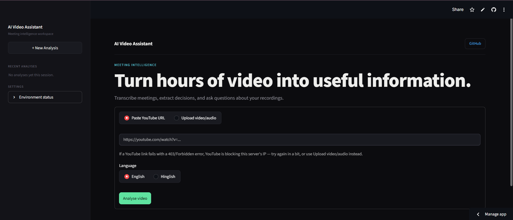
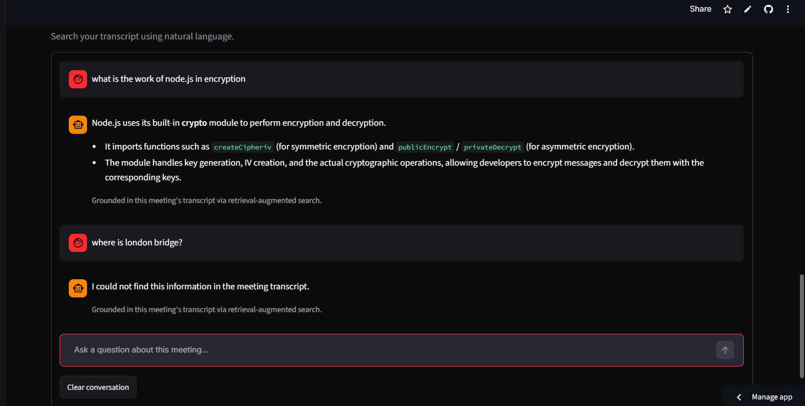
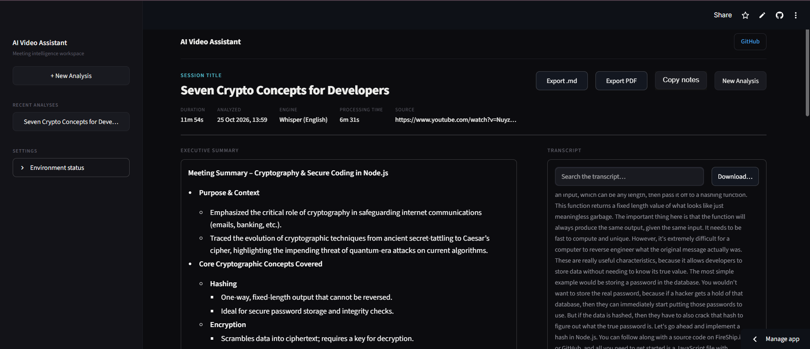
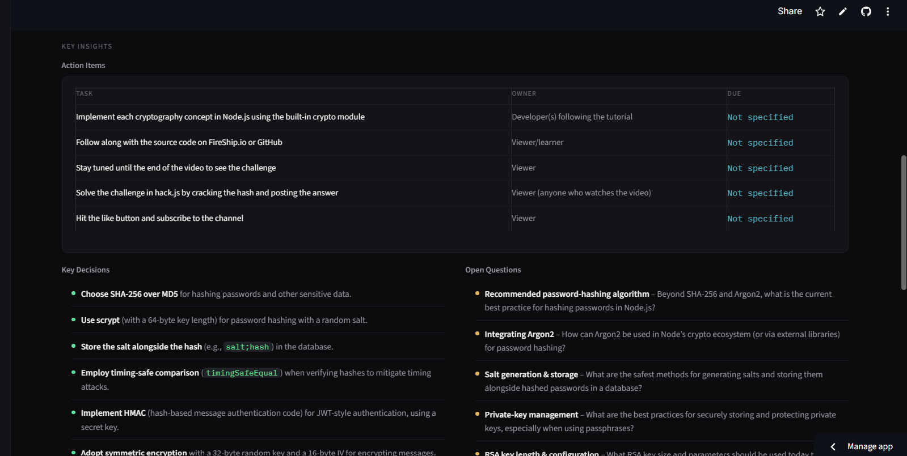

# AI Video Assistant

A Streamlit app that turns a YouTube link or an uploaded recording into a transcript, a summary, structured action items, key decisions and open questions, and a chat interface that answers questions from the transcript using retrieval-augmented generation (RAG).

Live demo: https://ai-rag-video-assistant-khi.streamlit.app/ (free-tier hosting, so it may take a moment to wake up; see [Limitations](#limitations) for what to expect with YouTube links).



## Overview

You give the app a YouTube URL or an audio/video file and choose English or Hinglish. It then:

1. Gets the audio and converts it to WAV.
2. Transcribes it: English through Whisper, Hinglish (Hindi mixed with English) through Sarvam AI, which returns English text.
3. Uses an LLM on Groq to write a title, a summary, action items, key decisions and open questions.
4. Splits the transcript into chunks, embeds them and stores them in ChromaDB, so you can ask questions about the video. Answers are restricted to the retrieved transcript text.

Results can be exported as Markdown or PDF.



## Features

- Input from a YouTube URL or an uploaded file (mp4, mp3, wav, m4a).
- English transcription, plus Hindi/Hinglish to English through Sarvam AI.
- Title, map-reduce summary, action items (parsed into a Task / Owner / Due table), key decisions and open questions.
- Transcript view with search and highlighting, and a `.txt` download.
- RAG chat with suggested questions. The prompt tells the model to answer only from the retrieved context, and to say "I could not find this information in the meeting transcript." otherwise.
- Progress checklist with a live elapsed-time counter while the pipeline runs.
- Export as Markdown or PDF, and copy-to-clipboard buttons for the notes and the transcript.
- Session history in the sidebar for analyses done since the page was opened.
- A command-line version (`main.py`) that runs the same pipeline and then starts a terminal chat loop.





## Tech stack

| Area | Technology |
|---|---|
| UI | Streamlit with custom CSS |
| LLM | Groq through `langchain-groq`, model `openai/gpt-oss-20b` (title, summary, extraction, chat) |
| Transcription, English | Groq-hosted `whisper-large-v3-turbo`, with local `openai-whisper` as a fallback |
| Transcription, Hinglish | Sarvam AI `speech-to-text-translate` (`saaras:v2.5`) |
| Embeddings | `all-MiniLM-L6-v2` through `sentence-transformers`, run locally on CPU |
| Vector store | ChromaDB, persisted in `vector_db/` |
| Audio | `yt-dlp` for downloads, `pydub` and ffmpeg for conversion and chunking |
| Orchestration | LangChain (LCEL) |
| PDF export | `fpdf2` |

## How it works

```
YouTube URL / uploaded file
        |
utils/audio_processor.py     download or convert -> 16 kHz mono WAV -> 10-minute chunks
        |
core/transcriber.py          English: Groq Whisper (local Whisper fallback)
        |                    Hinglish: Sarvam AI, 25-second pieces
        v
   full transcript
        |
        +-- core/summarizer.py   title, map-reduce summary
        +-- core/extractor.py    action items, decisions, open questions
        +-- core/rag_engine.py   chunk -> embed -> Chroma -> retriever -> LLM
```

**Audio.** For a URL, `yt-dlp` extracts audio and ffmpeg writes it as 16 kHz mono WAV, named by video ID. Uploaded files are converted with `pydub` to the same format. The WAV is then cut into 10-minute chunks.

**Transcription.** Each chunk is transcribed separately and the results are joined into one string. For English, the chunk is sent to Groq's hosted Whisper when `GROQ_API_KEY` is set. If that call fails, or `TRANSCRIBE_ENGINE=local` is set, it uses the local Whisper model (`WHISPER_MODEL`, default `small`). The local model is imported only when needed. Sarvam's synchronous API rejects audio longer than 30 seconds, so for Hinglish each chunk is sliced into 25-second pieces, sent one by one, and the returned English text is concatenated.

**Summary and title.** The transcript is split into 3000-character pieces with 200 characters of overlap. Each piece is summarised on its own (map), then the partial summaries are combined into one bullet-point summary (reduce). The title is generated from the first 2000 characters.

**Extraction.** Three separate LLM calls return action items, key decisions and open questions as numbered lists. The prompts tell the model to skip promotional lines such as "like and subscribe", and to answer in plain text. `app.py` parses each action item into task, owner and deadline for the table, and falls back to "Not specified" when a field is missing.

**Retrieval and chat.** The transcript is split into 500-character chunks with 50 characters of overlap, embedded with `all-MiniLM-L6-v2` and stored in a Chroma collection. A question retrieves the 4 most similar chunks, which are passed to the LLM with the grounding prompt. The embedding model is loaded once per process.

## Project structure

```
.
├── app.py                  Streamlit UI and pipeline orchestration
├── main.py                 CLI entry point (pipeline plus terminal chat loop)
├── test.py                 Smoke test against a hardcoded YouTube URL
├── core/
│   ├── transcriber.py      Groq Whisper / local Whisper / Sarvam, with chunking
│   ├── summarizer.py       Title and map-reduce summary
│   ├── extractor.py        Action items, decisions, open questions
│   ├── rag_engine.py       Retriever + LLM chain for chat
│   └── vector_store.py     Splitting, embeddings, Chroma
├── utils/
│   └── audio_processor.py  yt-dlp download, WAV conversion, chunking
├── requirements.txt
└── packages.txt            apt packages for Streamlit Community Cloud (ffmpeg)
```

## Getting started

### Prerequisites

- Python 3.10 or newer
- ffmpeg available on your `PATH`
- A [Groq API key](https://console.groq.com/keys)
- A [Sarvam AI API key](https://www.sarvam.ai/), only if you want the Hinglish option

On Python 3.13, `pydub` needs the `audioop-lts` package because `audioop` was removed from the standard library: `pip install audioop-lts`.

### Install

```bash
git clone https://github.com/Saaksshi18/ai-rag-video-assistant.git
cd ai-rag-video-assistant

python -m venv .venv
source .venv/bin/activate        # Windows: .venv\Scripts\activate

pip install -r requirements.txt
```

`requirements.txt` installs `yt-dlp[default,deno]`. YouTube downloads currently need a JavaScript runtime and the `yt-dlp-ejs` package, which these extras provide.

### Configure

Create a `.env` file in the project root:

```env
GROQ_API_KEY=your_groq_key
SARVAM_API_KEY=your_sarvam_key      # only for Hinglish
```

### Run

```bash
streamlit run app.py
```

or from the terminal:

```bash
python main.py
```

`main.py` asks for a URL or file path and a language, prints the results, then starts a chat loop (`exit` to quit).

## Usage

1. Choose **Paste YouTube URL** or **Upload video/audio**.
2. Choose English or Hinglish.
3. Click **Analyse video** and wait for the checklist to finish.
4. Read the summary and insights, search the transcript, export the report, or ask questions at the bottom of the page.

## Configuration

| Variable | Required | Purpose | Default |
|---|---|---|---|
| `GROQ_API_KEY` | Yes | LLM calls and hosted Whisper | none |
| `SARVAM_API_KEY` | For Hinglish | Hindi/Hinglish to English transcription | none |
| `WHISPER_MODEL` | No | Local Whisper size (`tiny`, `base`, `small`, ...) used as the fallback | `small` |
| `GROQ_WHISPER_MODEL` | No | Hosted Whisper model | `whisper-large-v3-turbo` |
| `TRANSCRIBE_ENGINE` | No | Set to `local` to skip Groq and always use local Whisper | `groq` |
| `SARVAM_STT_MODEL` | No | Sarvam model name | `saaras:v2.5` |
| `YT_COOKIES_BROWSER` | No | Read YouTube cookies from a local browser, for example `firefox` | none |
| `YT_COOKIES_FILE` | No | Path to a Netscape-format `cookies.txt` | none |
| `YT_COOKIES_B64` | No | Base64 of a `cookies.txt`, for hosted deployments | none |

## Deploying to Streamlit Community Cloud

1. Create the app from this repository with `app.py` as the main file. `packages.txt` installs ffmpeg.
2. Add secrets under Settings, Secrets. Top-level secrets are exposed to the app as environment variables:
   ```toml
   GROQ_API_KEY = "..."
   SARVAM_API_KEY = "..."
   YT_COOKIES_B64 = "..."      # optional, see below
   ```
3. Free-tier memory is limited. If the app is restricted for using too much memory, set `WHISPER_MODEL = "base"` or `"tiny"` for the local fallback.

## Implementation details

**YouTube downloads.** YouTube blocks or challenges many requests from cloud IP addresses, and the workarounds change often. `download_youtube_audio` handles this in layers:

- It detects an installed JavaScript runtime (Deno, Node or Bun) and passes it to yt-dlp.
- It tries yt-dlp's default clients first, then falls back through the `tv`, `mweb`, `web_embedded`, `android`, `ios` and `web` clients. It moves to the next client only on errors that look like a block or challenge (403, "sign in to confirm you're not a bot", missing formats, 429). Errors such as an unavailable video are raised immediately.
- It can attach cookies from a browser, a file or a base64 string, which is the most reliable option for the "not a bot" check.
- If every attempt fails, the error message says which piece is missing: JavaScript runtime, cookies, or an outdated yt-dlp.

Uploading a file bypasses YouTube completely and is the dependable path on hosted deployments.

**Transcription fallback.** `transcribe_chunk` tries Groq first and catches any exception from that call before falling back to local Whisper, so a rate limit or network error does not fail the whole analysis. A 429 response is retried once after the `retry-after` delay. Chunks above about 24 MB are re-encoded to 16 kHz mono before upload to stay under Groq's file size limit.

**Live progress.** The pipeline runs inside `st.status`. A background thread, attached to Streamlit's script context, updates the elapsed time and a rotating message every second, so a long analysis does not look stalled. The thread is stopped in a `finally` block.

## Limitations

- **YouTube on hosted deployments.** Streamlit Cloud IPs are often blocked by YouTube. Cookies help, but a download can still fail, and cookies expire. File upload always works.
- **No timestamps or speakers.** The transcript is one flat string. Chat answers do not cite a source passage or time.
- **One shared vector collection.** `build_vector_store` writes to the same persistent collection (`meeting_transcript` in `vector_db/`) for every video, so chunks from earlier videos stay in the index and can appear in later answers. Delete `vector_db/` to start clean.
- **Session-only results.** Results, chat and history live in `st.session_state` and are lost on refresh.
- **Free-tier limits.** Groq's free tier has rate and daily limits. If hosted Whisper fails, the local Whisper fallback is slow on a shared CPU and can exceed Streamlit Cloud's memory limit.
- **Long videos.** Processing time grows with length, because each 10-minute chunk is transcribed in turn and the summary makes one LLM call per 3000 characters.
- **Disk growth.** `downloades/` and `vector_db/` are gitignored but never cleaned up.

## Future improvements

- Carry timestamps from transcription through to chat answers, with source citations.
- Use one vector collection per video.
- Persist history across sessions.
- Stream chat responses.
- Speaker labels.
